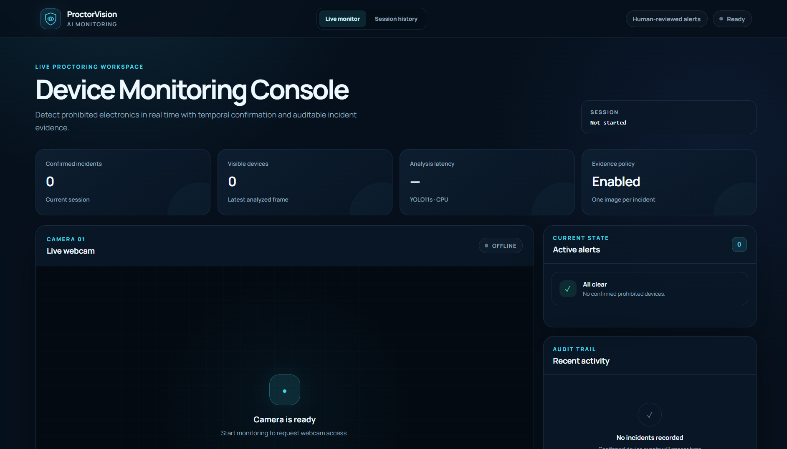
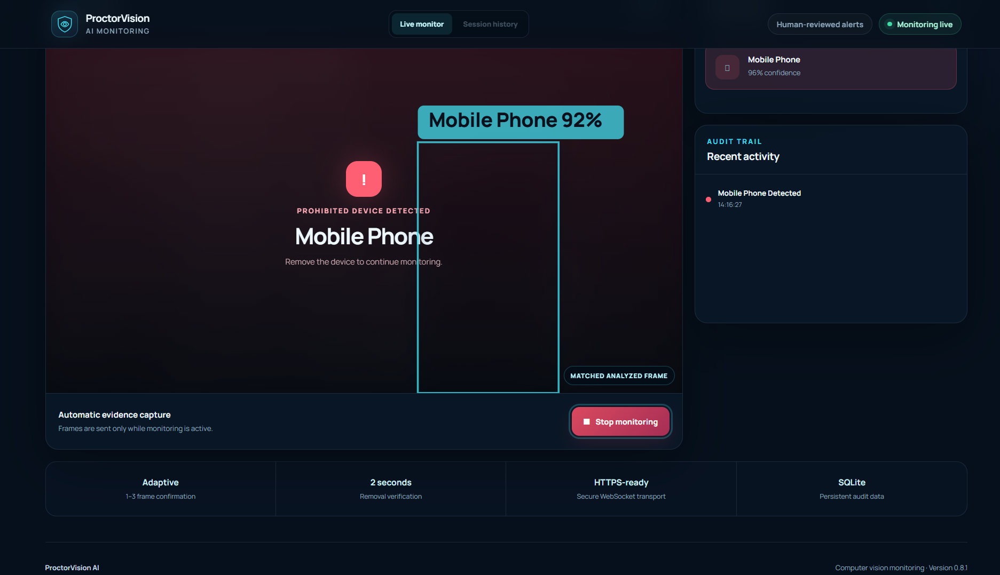
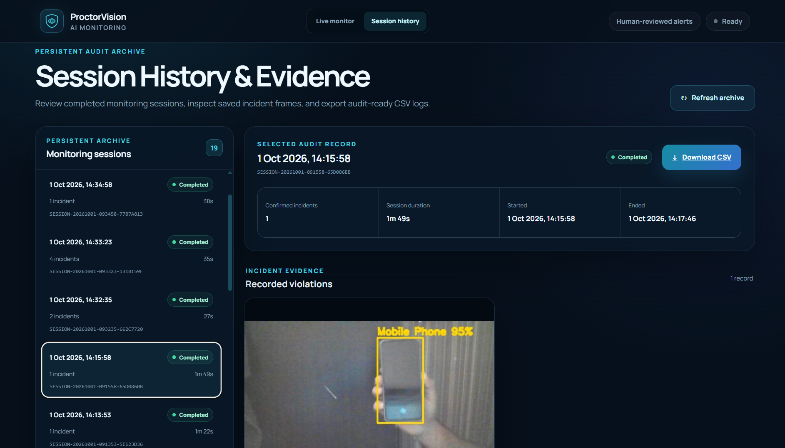
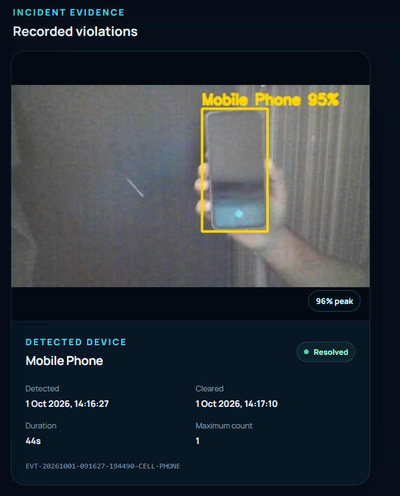
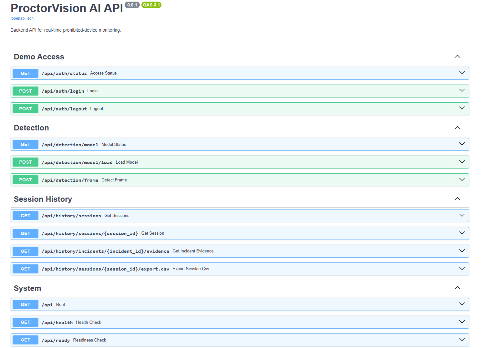
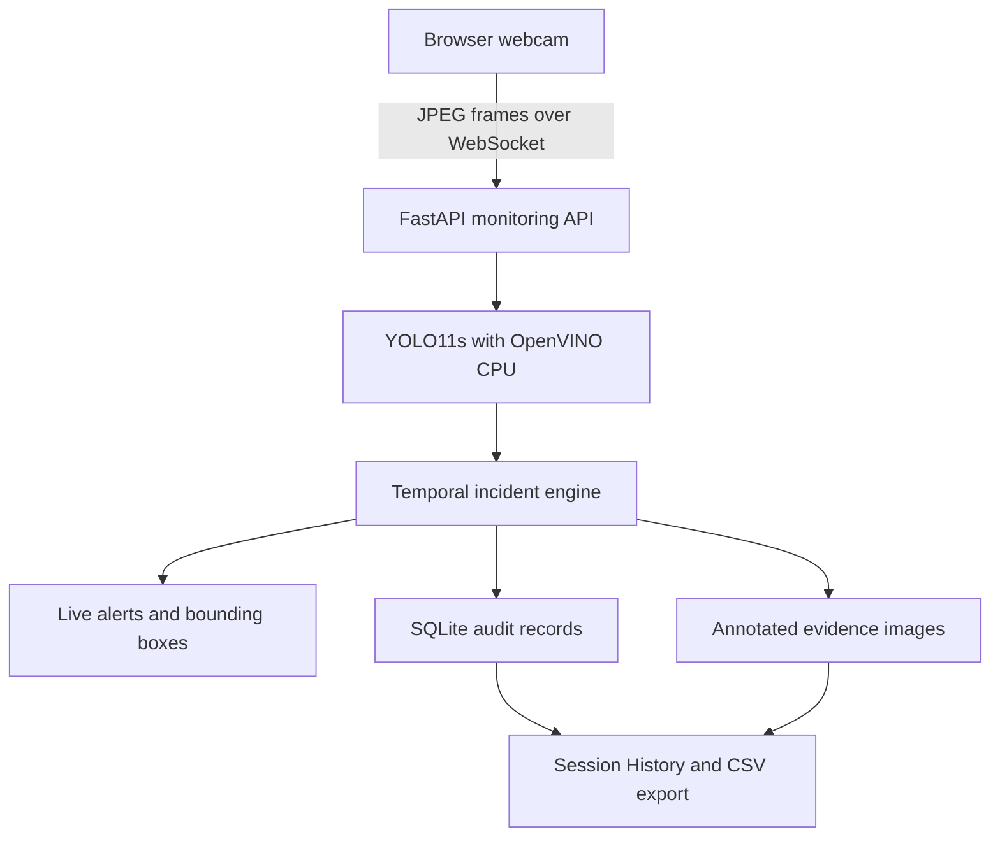

# ProctorVision AI

**Real-time prohibited-device detection with auditable session evidence.**

ProctorVision AI is a full-stack computer-vision monitoring system that analyzes
live webcam frames for mobile phones, laptops, and televisions/monitors. It
combines YOLO11s detection, OpenVINO CPU acceleration, temporal incident
confirmation, audible and visual alerts, evidence capture, persistent session
history, and CSV audit export.

It is designed as a human-review assistant for controlled online assessments
and monitored-session demonstrations, producing reviewable evidence instead of
making automated misconduct decisions.

> ProctorVision flags visual events for human review. A detection is not, by
> itself, proof of academic misconduct.

## Highlights

- Live browser webcam monitoring over WebSockets
- Three prohibited-device categories:
  - Mobile Phone
  - Laptop / Computer (laptop-class detection)
  - TV / LCD / Monitor
- Bounding boxes aligned with the exact analyzed frame
- OpenVINO CPU inference with automatic PyTorch fallback
- Adaptive 1–3 frame confirmation based on confidence
- Preview blocking and audible alert for confirmed incidents
- Automatic resolution after verified device removal
- One annotated evidence image per incident
- SQLite session and incident persistence
- Session History interface with evidence review
- Excel-friendly per-session CSV export
- Optional private supervisor access gate
- Same-origin production frontend, API, and secure WebSocket support
- Docker and Windows PowerShell handover workflows

## Application screenshots

The screenshots below use controlled demonstration data and do not expose a
participant's face or private surroundings. Select any image to view it at full
resolution.

### Live monitoring dashboard

[](docs/screenshots/live-dashboard.png)

The monitoring workspace presents camera controls, connection state, runtime
metrics, active-alert status and the live audit trail in one interface.

### Confirmed device alert

[](docs/screenshots/phone-detection-alert.png)

A confirmed phone detection displays the analyzed-frame bounding box, blocks
the preview for privacy and instructs the participant to remove the device.

### Session history

[](docs/screenshots/session-history.png)

Completed monitoring sessions remain available for audit, including their
status, timing, incident totals and CSV export.

### Incident evidence

[](docs/screenshots/evidence-review.png)

Each confirmed incident retains one annotated evidence frame together with its
device type, peak confidence, duration, resolution state and event identifier.

### Interactive API documentation

[](docs/screenshots/api-documentation.png)

FastAPI provides interactive OpenAPI documentation for access control,
detection, session history and system-health endpoints.

## System architecture



Only one frame is in flight from a browser at a time. This prevents a slow
backend from accumulating stale frames and keeps displayed detections aligned
with the image that was actually analyzed.

## Technology stack

| Layer | Technology |
|---|---|
| Detection | Ultralytics YOLO11s |
| CPU acceleration | OpenVINO |
| Backend | Python 3.12, FastAPI, Uvicorn |
| Real-time transport | WebSockets |
| Persistence | SQLAlchemy, SQLite |
| Image processing | OpenCV, NumPy |
| Frontend | React 19, Vite 8 |
| Testing | Pytest, Node test runner |
| Packaging | Docker, Docker Compose, PowerShell |

## Detection lifecycle

1. The user starts monitoring and grants camera access.
2. The browser sends a compressed frame only when no earlier frame is awaiting
   a response.
3. YOLO11s detects supported device classes through OpenVINO CPU inference.
4. Per-class confidence and geometry filters reject weak or implausible boxes.
5. The incident engine confirms a device using confidence-adaptive temporal
   rules.
6. A confirmed incident triggers an alert, blocks the preview, sounds a tone,
   and saves annotated evidence.
7. After the device remains absent for the configured clear delay, the incident
   is marked resolved and normal monitoring resumes.
8. Stopping monitoring finalizes the session for later review and CSV export.

## Quick start on Windows

### Prerequisites

- Windows 10 or 11
- Python 3.12
- Node.js 22 recommended (Node.js 20.19 or newer is required by Vite 8)
- Git
- A working webcam

From PowerShell in the project root:

```powershell
Set-ExecutionPolicy -Scope Process -ExecutionPolicy RemoteSigned
.\scripts\setup.ps1
.\scripts\start.ps1
```

Open <http://127.0.0.1:8000>. The production React build and FastAPI backend are
served from one process, so only one terminal is required.

The initial setup installs dependencies, obtains YOLO11s if it is absent,
prepares the OpenVINO export, runs both test suites, and builds the frontend.

## Development mode

Use two terminals when changing frontend or backend code.

Backend:

```powershell
cd E:\ProctorVision_AI
.\.venv\Scripts\Activate.ps1
python -m uvicorn app.main:app --app-dir backend --reload
```

Frontend:

```powershell
cd E:\ProctorVision_AI\frontend
npm run dev
```

Open <http://127.0.0.1:5173>. Vite proxies `/api` HTTP and WebSocket traffic to
the backend on port 8000, so production and development use the same URL model.

## Verification

Run the complete automated check:

```powershell
.\scripts\verify.ps1
```

Or run each part manually:

```powershell
python -m pytest .\backend\tests -v
cd .\frontend
npm test
npm run build
```

Phase 8.1 release baseline:

| Verification | Result |
|---|---:|
| Backend tests | 32 passed |
| Frontend tests | 8 passed |
| Vite production build | Passed |
| Fresh live-to-history workflow | Passed |
| Evidence and CSV cross-check | Passed |

The one remaining warning is an upstream FastAPI/Starlette TestClient
deprecation notice; it does not affect application behavior.

See the [changelog](CHANGELOG.md) and
[Phase 8.1 release notes](docs/phase8-1-release-cleanup.md) for the final
repository-cleanup changes.

## Observed development-machine performance

Controlled manual testing was performed on:

- Intel Core i5-6300U, 2 cores / 4 logical processors
- Intel HD Graphics 520
- CPU-only PyTorch installation
- OpenVINO CPU runtime for active inference

Observed interface round-trip latency was below 100 ms in some non-recording
tests and approximately 300–500 ms during the improved screen-recorded test.
In the final recorded phone acceptance cycle, the device was clearly visible
for approximately 1.25 seconds before the confirmed alert appeared; one later
frame displayed 1,695 ms model latency while the screen recorder was competing
for the same two-core CPU. These are development observations, not universal
benchmark guarantees or averages. Cloud latency depends on server CPU,
geographic distance, network quality, and the number of simultaneous users.

Use the included warmed-model benchmark for host comparisons:

```powershell
python .\backend\scripts\benchmark_detector.py --runs 20
```

## Private supervisor demonstration

Local development is open by default. Before exposing the application through
a public URL, set a long, temporary access token in `.env`:

```dotenv
PROCTORVISION_ENVIRONMENT=production
PROCTORVISION_ACCESS_TOKEN=replace-with-a-long-random-value
PROCTORVISION_SECURE_COOKIES=true
```

The frontend then displays a supervisor access screen. Successful authentication
creates an HTTP-only cookie; history, evidence, API documentation, and live
monitoring WebSockets remain blocked without it.

This is a lightweight single-reviewer demonstration gate, not a replacement for
institutional identity management or role-based access control.

## Docker

Copy `.env.example` to `.env`, set a temporary access token if required, then:

```powershell
docker compose up --build
```

Open <http://127.0.0.1:8000>. Docker builds the React frontend, downloads the
official YOLO11s weights, exports OpenVINO, and stores database/evidence data in
the `proctorvision-storage` volume.

For an internet deployment, terminate TLS at the hosting platform or reverse
proxy, forward HTTP and WebSocket traffic to port 8000, and set
`PROCTORVISION_SECURE_COOKIES=true`.

See [Deployment Guide](docs/deployment.md) for the production checklist.

## Configuration

Backend variables use the `PROCTORVISION_` prefix.

| Variable | Default | Purpose |
|---|---|---|
| `PROCTORVISION_PREFER_OPENVINO` | `true` | Prefer the exported OpenVINO model |
| `PROCTORVISION_PRELOAD_MODEL` | `true` | Load and warm the detector at startup |
| `PROCTORVISION_DATABASE_PATH` | `data/proctorvision.db` | SQLite audit database |
| `PROCTORVISION_EVIDENCE_DIRECTORY` | `evidence/` | Incident image storage |
| `PROCTORVISION_ACCESS_TOKEN` | empty | Enables private-demo access protection |
| `PROCTORVISION_SECURE_COOKIES` | `false` | Requires HTTPS for the access cookie |
| `PROCTORVISION_CORS_ORIGINS` | local Vite origins | Allowed cross-origin development clients |
| `PROCTORVISION_IMAGE_SIZE` | `416` | Model inference image size |
| `PROCTORVISION_INCIDENT_CLEAR_DELAY_SECONDS` | `2.0` | Device-removal verification delay |
| `PROCTORVISION_MAXIMUM_WEBSOCKET_FRAME_BYTES` | `3145728` | Maximum frame payload size |

Detection thresholds and confirmation settings are also environment-aware. Keep
the validated defaults unless a documented evaluation justifies a change.

## API overview

| Method | Endpoint | Purpose |
|---|---|---|
| `GET` | `/api/health` | Process liveness and runtime summary |
| `GET` | `/api/ready` | Database and loaded-detector readiness |
| `GET` | `/api/detection/model` | Model status |
| `POST` | `/api/detection/frame` | Single-image detection |
| `WS` | `/api/ws/monitoring` | Live monitoring session |
| `GET` | `/api/history/sessions` | Session archive |
| `GET` | `/api/history/sessions/{id}` | Session and incident detail |
| `GET` | `/api/history/incidents/{id}/evidence` | Saved evidence image |
| `GET` | `/api/history/sessions/{id}/export.csv` | Excel-friendly CSV export |
| `GET` | `/docs` | Interactive OpenAPI documentation |

## Project structure

```text
ProctorVision_AI/
├── backend/
│   ├── app/
│   │   ├── api/           # Detection, monitoring, history, access
│   │   ├── core/          # Configuration and security helpers
│   │   ├── database/      # SQLAlchemy models and repository
│   │   ├── detection/     # YOLO/OpenVINO service and schemas
│   │   └── services/      # Evidence and incident lifecycle
│   ├── scripts/           # Model export and benchmark tools
│   └── tests/
├── frontend/
│   └── src/               # React console, hooks, components, tests
├── docs/
│   └── screenshots/       # Public README demonstration images
├── scripts/               # Windows setup, start, and verification
├── Dockerfile
├── docker-compose.yml
└── README.md
```

Runtime-only paths such as `.env`, `data/`, `evidence/`, the OpenVINO export,
Node modules, and recorded media are intentionally excluded from Git.

## Supervisor acceptance walkthrough

1. Open the protected deployment and enter the supplied temporary token.
2. Open **Live monitor** and select **Start monitoring**.
3. Confirm that the runtime metric displays **OpenVINO CPU**.
4. Present one mobile phone until its bounding box and alert appear.
5. Remove it and wait for **All clear**.
6. Repeat with a laptop and a monitor where available.
7. Stop monitoring before opening **Session history**.
8. Confirm the session status, incident timing, evidence and peak confidence.
9. Download the CSV and compare its incident ID with the evidence filename.
10. Review `/docs`, the automated test output, and the repository structure.

The detailed controlled test is in
[Evaluation Protocol](docs/evaluation-protocol.md).

## Privacy and responsible use

- Camera access begins only after an explicit user action and browser consent.
- Frames are analyzed while monitoring is active; the application does not save
  a continuous video recording.
- One annotated image is retained for each confirmed incident.
- Session metadata, timestamps, confidence and evidence paths are retained in
  the configured database/storage.
- A real deployment must define consent, access, retention and deletion rules.
- Do not publish real participant evidence in a public repository.

See [Privacy Notes](PRIVACY.md) and [Security Policy](SECURITY.md).

## Current scope and limitations

- The baseline is validated for one active reviewer/session on a single server.
- SQLite and local evidence storage are intended for one-instance deployment.
- Horizontal scaling requires shared session state, PostgreSQL and object
  storage.
- Detection quality depends on lighting, camera quality, distance, occlusion and
  whether the target resembles the model's training data.
- Desktop computer towers are outside the confirmed project scope.
- Formal precision, recall and false-positive metrics require a labelled
  evaluation dataset and are not claimed yet.

## Roadmap

- Labelled device/no-device evaluation set and accuracy report
- Stable device tracking across frames
- PostgreSQL and object-storage adapters
- Institutional login and role-based access control
- Multi-session load testing and inference queueing
- Domain-specific fine-tuning for webcam examination scenes

## Licensing and third-party models

Ultralytics states that its YOLO software and trained models are AGPL-3.0 by
default, with enterprise licensing available for proprietary commercial use.
Before selecting a project-level license or commercial deployment model,
confirm the intended distribution terms and all applicable third-party
licensing requirements.

See [Third-Party Notices](THIRD_PARTY_NOTICES.md). This section is informational
and is not legal advice.

## Author

**Muhammad Raza Shah**<br>
BS Information Engineering Technology, The Superior University, Lahore<br>
[GitHub](https://github.com/razashahm9-alt) ·
[LinkedIn](https://www.linkedin.com/in/muhammad-raza-shah)
